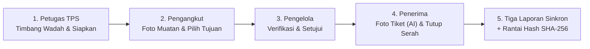

<div align="center">


# SERAH
### *Satu serah, tiga laporan.*

**Platform PWA Kolaboratif Pengelolaan Sampah Kawasan Mandiri Berbasis Bukti Kriptografis & Integritas Regulasi**

[](https://serah-production.up.railway.app)
[](https://serah-production.up.railway.app/demo)

[](https://nextjs.org/)
[](https://www.typescriptlang.org/)
[](https://www.postgresql.org/)
[](https://developer.mozilla.org/)
[-D97706?style=flat-square&logo=anthropic)](https://www.anthropic.com/)
[](https://jdih.jakarta.go.id)

<br/>

> **"Sampah yang berpindah tangan cukup dicatat sekali, divalidasi bersama oleh pengangkut dan penerima, dan seketika menjadi laporan resmi ketiga pihak tanpa selisih angka."**

</div>

---

## 🧭 Navigasi Cepat
- [🚀 Panduan Khusus Juri (Test Drive 3 Menit)](#-panduan-khusus-juri-test-drive-3-menit)
- [🌱 Latar Belakang & Masalah Riil](#-latar-belakang--masalah-riil)
- [✨ Fitur & Inovasi Utama](#-fitur--inovasi-utama)
- [⚖️ Penegakan Regulasi Otomatis (R-01 s/d R-11)](#️-penegakan-regulasi-otomatis)
- [🤖 Pemanfaatan AI: Tepat Guna & Hemat](#-pemanfaatan-ai-tepat-guna--hemat)
- [🏗️ Arsitektur & Kualitas Rekayasa](#️-arsitektur--kualitas-rekayasa)
- [💻 Menjalankan Secara Lokal](#-menjalankan-secara-lokal)
- [🛡️ Privasi & Batasan Etika Sistem](#️-privasi--batasan-etika-sistem)

---

## 🚀 Panduan Khusus Juri (Test Drive 3 Menit)

Aplikasi telah terpasang penuh di lingkungan produksi. **Anda tidak perlu mendaftar atau mengingat kata sandi.**

### 🔗 Tautan Pengujian
* **Simulasi 4 Peran Sekaligus (Sangat Disarankan):**  
  👉 **[serah-production.up.railway.app/demo](https://serah-production.up.railway.app/demo)**  
  *(Memantau 4 layar peran secara berdampingan dalam satu jendela browser)*
* **Akses Masuk Standar:**  
  👉 **[serah-production.up.railway.app/masuk](https://serah-production.up.railway.app/masuk)**

---

### 🔑 Akun Demo 1-Klik (`DEMO_MODE`)

Di halaman masuk, cukup klik salah satu tombol peran di bawah judul *Coba dengan akun demo*:

| Urutan | Peran | Email Akun Demo | Tugas Utama dalam Alur |
| :---: | :--- | :--- | :--- |
| **1** | **Petugas TPS** | `petugas@demo.serah.id` | Input timbangan per wadah warna di TPS (PWA offline-ready), siapkan serah |
| **2** | **Pengangkut** | `pengangkut@demo.serah.id` | Ambil muatan, foto bukti fisik, validasi tujuan sesuai izin Pergub |
| **3** | **Pengelola Kawasan** | `pengelola@demo.serah.id` | Setujui pengangkutan, pantau peta TPS, awasi neraca & peringatan BMKG |
| **4** | **Penerima (Daur Ulang)** | `penerima@demo.serah.id` | Foto struk timbangan (dibaca AI), verifikasi berat sah, tutup serah |
| — | **Admin** | `admin@demo.serah.id` | Audit jejak integritas rantai catatan (Hash Chain SHA-256) — tanpa tombol demo, akun hanya ada di basis data |

> 💡 *Tips:* Satu peramban menyimpan satu sesi aktif. Gunakan tab penyamaran (*incognito*) berbeda atau gunakan langsung halaman **[/demo](https://serah-production.up.railway.app/demo)** untuk mencoba antar-peran sekaligus.
>
> 🧪 *Catatan: semua nama organisasi, kawasan, dan akun pada mode demo adalah rekaan; tidak ada usaha sungguhan yang dirujuk.*

---

### 🎬 Alur Uji Coba Transaksi Penuh (End-to-End)



1. **Langkah 1 (Petugas TPS):**
   * Pilih TPS demo (pindai QR atau ketik kode).
   * Catat timbangan: contoh **Wadah Kuning (Daur Ulang) 42,5 kg** dan **Abu-abu (Residu) 30 kg**.
   * Klik **Siapkan Serah** khusus untuk wadah Kuning.
2. **Langkah 2 (Pengangkut):**
   * Ambil serah yang siap diangkut $\rightarrow$ Ambil/unggah foto muatan truk.
   * *Uji Aturan Regulasi:* Coba pilih tujuan **TPST Rawa Kuning (TPA)**. Sistem akan **menolak otomatis** dengan menampilkan dasar hukum **Aturan R-01 (Pergub DKI 102/2021 Ps. 20(2)(d))** karena sampah daur ulang dilarang dibuang ke TPA!
   * Ganti tujuan ke mitra berizin: **CV Daur Ulang Mandiri** $\rightarrow$ Kirim.
3. **Langkah 3 (Pengelola Kawasan):**
   * Masuk sebagai Pengelola $\rightarrow$ Klik **Setujui Pengangkutan**.
4. **Langkah 4 (Penerima):**
   * Foto tiket/struk timbangan jembatan timbang.
   * **Vision AI (Claude Haiku)** mengekstrak nomor tiket & berat netto secara otomatis ke form.
   * Konfirmasi angka $\rightarrow$ Terima sebagian (misal: diterima 36,5 kg dan ditolak 6 kg karena kontaminasi minyak) $\rightarrow$ Tutup Serah.
5. **Langkah 5 (Hasil Akhir):**
   * Kembali ke layar Pengelola: **3 Laporan (Kawasan, Pengangkut, Penerima) langsung sinkron serentak tanpa rekonsiliasi manual.**
   * Buka menu *Periksa Rantai Catatan* untuk membuktikan segel hash kriptografis yang tidak dapat diubah (*tamper-evident*).

---

## 🌱 Latar Belakang & Masalah Riil

**Peraturan Gubernur DKI Jakarta No. 102 Tahun 2021** mewajibkan pengelola kawasan (pasar swasta, kawasan komersial, apartemen, pusat kuliner) untuk mengelola dan melaporkan sampahnya secara mandiri:
* Memilah ke **4 wadah warna** (Hijau: Mudah Terurai, Kuning: Daur Ulang, Merah: B3 Rumah Tangga, Abu-abu: Residu).
* Memastikan hanya sampah residu yang berakhir di TPA Bantar Gebang.
* Menyerahkan sampah daur ulang hanya kepada pengolah/penerima resmi berizin.

### Perbandingan: Sebelum vs Sesudah SERAH

| Masalah Konvensional Lapangan | Solusi Inovatif SERAH |
| :--- | :--- |
| **Pencatatan 3 Kali di Kertas:** Kawasan mencatat di nota, pengangkut mencatat di surat jalan, pabrik daur ulang mencatat di tiket jembatan timbang. Di akhir bulan, angka sering selisih dan terjadi sengketa pembayaran. | **Single Source of Truth:** Satu transaksi serah ditutup bersama secara digital. Laporan ketiga pihak otomatis terbit dari record yang sama. |
| **Material Ditolak Tanpa Jejak:** Sampah daur ulang basah/kotor ditolak pabrik tanpa informasi balik ke petugas pemilah di TPS. | **Looping Umpan Balik Mutu:** Alasan penolakan dicatat terstruktur dan dihitung potensi kerugian materialnya agar TPS memperbaiki pemilahan di hulu. |
| **Pengangkutan Tanpa Izin:** Pengangkutan sampah ke tujuan yang tidak berizin atau pembuangan non-residu ke TPA tanpa manifes terverifikasi. | **Enforcement di Level Kode:** Sistem menolak pengiriman ke tujuan yang tidak memiliki kontrak resmi atau izin klasifikasi sampah yang sah. |
| **Koneksi Blank-Spot di TPS:** Petugas di basement pasar sering tidak memiliki sinyal seluler. | **Offline-First PWA:** Catat timbangan di IndexedDB lokal secara instan, otomatis tersinkronisasi idempoten saat sinyal kembali. |

---

## ✨ Fitur & Inovasi Utama

* 📱 **PWA Offline-First:** Antarmuka gesit dengan IndexedDB. Bekerja mulus di area basement pasar tanpa koneksi internet.
* 🌦️ **Prioritas Angkut Berbasis Cuaca BMKG:** Mengintegrasikan API cuaca terbuka BMKG. Tumpukan sampah plastik yang mendekati ambang batas dan terancam hujan lebat otomatis dinaikkan statusnya menjadi **Prioritas Angkut** guna mitigasi genangan air pada saluran drainase.
* 🔐 **Buku Kas Kriptografis (SHA-256 Hash Chain):** Setiap transisi status serah disegel dalam rantai hash per kawasan. Dilengkapi tabel bukti *append-only* di PostgreSQL (trigger + pencabutan hak delete/update) untuk transparansi audit.
* 🎫 **AI Ticket Vision Reader:** Digitalisasi tiket timbangan fisik kotor/dot-matrix secara instan dengan pendekatan *Human-in-the-Loop*.
* 🗺️ **Peta Interaktif TPS & Manifes Angkut:** Titik lokasi TPS berbasis Leaflet dan OpenStreetMap tanpa ketergantungan pada pelacakan GPS personal sopir.
* 💳 **Integrasi Tagihan & Pembayaran (Sandbox):** Terintegrasi payment gateway Midtrans mode uji dan bukti transfer manual untuk langganan kawasan.

---

## ⚖️ Penegakan Regulasi Otomatis

SERAH menanamkan kepatuhan hukum langsung ke dalam state machine transaksi melalui **11 Aturan Sistem (R-01 s/d R-11)**:

| Kode | Landasan Regulasi | Perilaku Proteksi Sistem |
| :---: | :--- | :--- |
| **R-01** | Pergub DKI 102/2021 Ps. 20(2)(d) | **Menolak keras** tujuan TPA/TPST untuk muatan selain residu (Abu-abu). |
| **R-02** | Pergub DKI 102/2021 Ps. 20(2)(b) | Menolak pengiriman ke penerima tanpa kontrak aktif untuk jenis aliran sampah terkait. |
| **R-03** | Pergub DKI 102/2021 Ps. 19(2)(c) | Menolak penerima yang tidak tercatat menerima aliran sampah tersebut. |
| **R-04** | Integritas Bukti Visual | Menjaga keabsahan bukti dengan menolak foto muatan yang sangat mirip foto sebelumnya (perceptual hash). |
| **R-05** | Pergub DKI 102/2021 Ps. 8(1)(g) | Peringatan otomatis jika wadah tidak mudah terurai (Kuning, Merah, Abu-abu) melewati batas tampung 3 hari. |
| **R-06** | Pergub DKI 102/2021 Ps. 8(1)(h) | Peringatan otomatis jika wadah mudah terurai (Hijau) melewati batas tampung 1 hari. |
| **R-07** | Integritas Waktu Serah | Menandai transaksi berstatus anomali jika tidak ditutup penerima dalam waktu >12 jam. |
| **R-08** | Integritas Timbangan | Memunculkan peringatan audit jika selisih berat tiket penerima vs catatan awal TPS $>20\%$. |
| **R-09** | Pergub DKI 102/2021 Ps. 13(4)(a) | Peringatan kawasan jika ada TPS aktif yang tidak memiliki catatan timbangan harian. |
| **R-10** | Pergub DKI 102/2021 + Data BMKG | Menaikkan status prioritas angkut saat curah hujan ekstrem diprakirakan di kelurahan TPS. |
| **R-11** | Pergub DKI 102/2021 Ps. 1 angka 21 | Mengunci kontrak dan penyerahan sampah ke mitra penerima yang izin operasionalnya belum tervalidasi. |

---

## 🤖 Pemanfaatan AI: Tepat Guna & Hemat

SERAH memegang prinsip **AI yang bertanggung jawab, deterministik, dan terukur secara biaya**:

1. **Lingkup Tugas Spesifik:**  
   AI hanya digunakan untuk satu tugas: **Membaca foto tiket timbang jembatan timbang** menggunakan model multimodal vision **Claude Haiku 5.5** (`claude-haiku-5-5`), dengan **Claude Sonnet 5.5** (`claude-sonnet-5-5`) sebagai fail-safe cadangan.
2. **Efisiensi Biaya Maksimal:**
   * Fitur *extended thinking* dinonaktifkan pada model utama (`thinking: disabled`); model cadangan memakai mode yang didukungnya.
   * Output dibatasi hanya `max_tokens: 400` menggunakan skema JSON terstruktur (*Structured Outputs*).
   * Biaya operasional hanya $\approx$ **Rp 20 – Rp 30 per pembacaan tiket**.
3. **Prinsip Human-in-the-Loop:**  
   AI **tidak pernah mengambil keputusan final secara otonom**. Hasil pembacaan hanya mengisi saran nilai (*prefill form*); operator manusia wajib memeriksa dan menekan tombol konfirmasi.
4. **Logika Bisnis Bersih:**  
   Semua kalkulasi neraca sampah, konversi satuan, pembagian royalti daur ulang, dan pengujian aturan hukum dieksekusi oleh mesin deterministik murni TypeScript & BigInt di `@serah/core`, bebas dari risiko halusinasi LLM.

---

## 🏗️ Arsitektur & Kualitas Rekayasa

Aplikasi dibangun dengan arsitektur monorepo modular berstandar enterprise:

```
serah/
├── apps/
│   └── web/            # Next.js 16 (App Router), Server Actions, SSE, Offline Service Worker
└── packages/
    ├── core/           # State machine, Aturan R-01..R-11, Hash chain SHA-256, Neraca massa
    ├── kontrak/        # Skema Zod, Enums, Kontrak API, Seluruh kamus teks antarmuka
    ├── db/             # Prisma 7, Skema SQL, RLS Policies, Tabel Append-Only, Seed Data
    └── ui/             # Desain sistem responsif, Palet warna ramah mata, Ikonografi
```

* **Keamanan Data Multi-Tenant:** Isolasi tingkat baris (*Row-Level Security* / RLS) di PostgreSQL. Akun aplikasi tidak pernah menggunakan hak *superuser*.
* **Real-time Synchronized:** Menggunakan PostgreSQL `LISTEN/NOTIFY` yang dipancarkan ke browser klien melalui *Server-Sent Events* (SSE).
* **Perhitungan Tanpa Pembulatan Pecah:** Seluruh berat disimpan dalam satuan integer **Gram** ($g$) dan uang dalam **Rupiah** ($\text{Rp}$) untuk menghindari galat floating point IEEE-754.

---

## 💻 Menjalankan Secara Lokal

### Prasyarat
* **Node.js:** Versi 24 LTS
* **Package Manager:** `pnpm` (v9+)
* **Docker:** Untuk PostgreSQL 16 lokal

### Langkah Cepat
```bash
# 1. Klon repositori
git clone https://github.com/codezeros18/serah.git
cd serah

# 2. Pasang dependensi
pnpm install

# 3. Siapkan environment
cp .env.example .env
# Wajib: isi TOKEN_PEPPER & SESI_SECRET (min. 32 karakter acak)
# Untuk mencoba alur demo: DEMO_MODE=true

# 4. Jalankan database Docker & migrasi skema
pnpm db:up
pnpm --filter @serah/db db:migrate
pnpm --filter @serah/db db:seed

# 5. Jalankan server pengembangan
pnpm dev
```
Buka **http://localhost:3000/demo** di browser Anda.

### Uji Kualitas Kode (Test Suites)
```bash
pnpm verify          # Linting + Typecheck + Uji Aturan Struktural
pnpm test            # Unit Test & Integration Test (Vitest)
pnpm test:e2e        # Pengujian End-to-End Layar HP & Laptop (Playwright)
pnpm guard           # Pemeriksaan batas arsitektur paket & integritas privasi
```
Sekali saja sebelum menjalankan uji E2E: `pnpm --filter @serah/web exec playwright install chromium`.

---

## 🛡️ Privasi & Batasan Etika Sistem

### Yang Dilakukan SERAH untuk Melindungi Pekerja:
* **Tanpa Pelacakan Lokasi Person:** Tidak ada GPS tracking terhadap petugas pemilah, sopir truk, atau supir gerobak. Yang terdata hanya lokasi fisik fasilitas TPS resmi.
* **Pembersihan Metadata Gambar:** Foto bukti muatan dibersihkan dari metadata EXIF koordinat GPS kamera secara otomatis sebelum disimpan.
* **Audit Trail Bersih:** Catatan operasional mencatat *peran* dan organisasi, bukan melacak profil individu masyarakat/pedagang.

### Batasan Ruang Lingkup Sistem:
* SERAH **bukan timbangan digital IoT**: data berat berasal dari input jujur petugas TPS dan struk timbangan jembatan timbang resmi penerima.
* SERAH **bukan portal pemerintah**: SERAH menyiapkan berkas neraca terverifikasi yang siap dilaporkan ke sistem Dinas Lingkungan Hidup (DLH).
* SERAH fokus pada sampah kawasan sejenis domestik dan **tidak menangani limbah B3 industri berbahaya**.

---

## 📚 Sumber Data & Atribusi

* **Cuaca:** data terbuka BMKG (data.bmkg.go.id) untuk prakiraan & peringatan dini hujan.
* **Peta:** © OpenStreetMap contributors; pencarian alamat via Nominatim; dirender dengan Leaflet.
* **Regulasi:** Pergub DKI Jakarta No. 102/2021 — JDIH Provinsi DKI Jakarta.

---

## 👥 Tim & Pengembang

Dikembangkan dengan dedikasi penuh untuk **Hackathon JOINTS × INSPIRE 2026 (Universitas Gadjah Mada)** pada kategori **Sustainability**:
* Solusi nyata bagi pasar tradisional, UMKM kuliner, dan kawasan mandiri untuk mencapai nol sengketa sampah.

© 2026 **Tim SERAH**. Seluruh kode merupakan karya orisinal untuk kompetisi JOINTS × INSPIRE 2026.
